Карпушова 9/3-РПО-24/2

## Пример 1. 02_first_measurement.py
**Скриншот:**

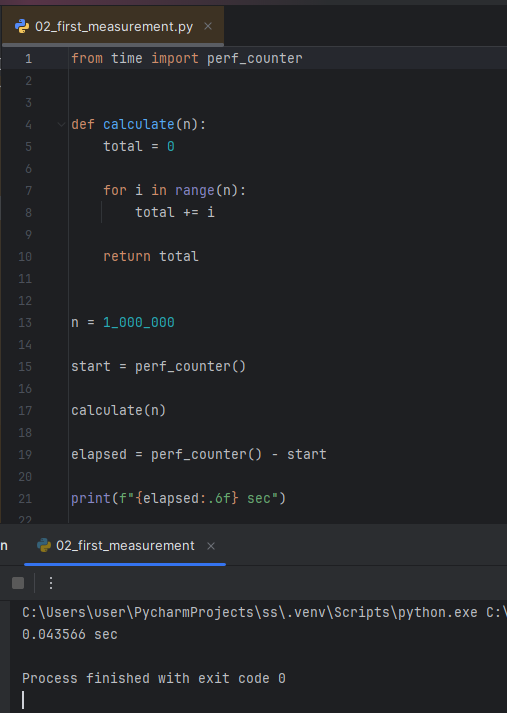

**Что измерялось:** время, затраченное на суммирование всех чисел от 1 до 1 000 000.
**Результат:** 0.436 секунд
**Вывод:** простое суммирование чисел, даже миллиона, выполняется очень быстро (меньше секунды).

## Пример 2. 03_growth_experiment.py
**Скриншот:**

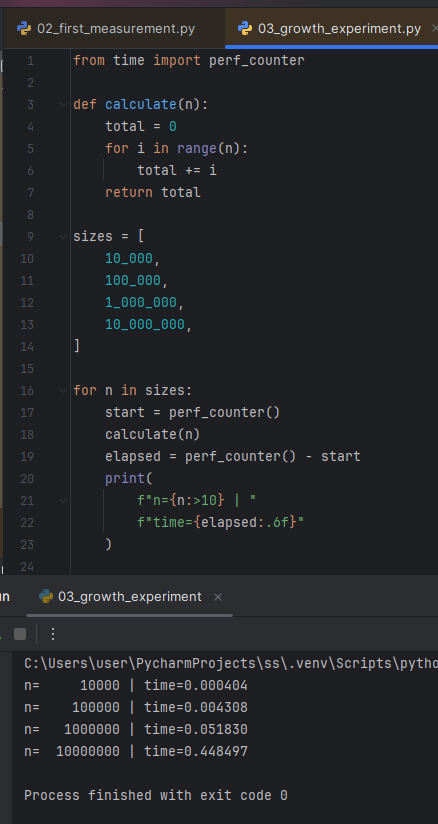

**Что измерялось:** время, затраченное на суммирование чисел от 1 до 10 000, 100 000, 1 000 000 и 10 000 000 по порядку.
**Результат:** 10 000 - 0.0004, 100 000 - 0.004, 1 000 000 - 0.05, 10 000 000 - 0.45.
**Вывод:** при увеличении числа в 10 раз (т.е размера входных данных), время подсчёта увеличивается также в ~10 раз.

## Пример 3. 04_constant_access.py
**Скриншот:**

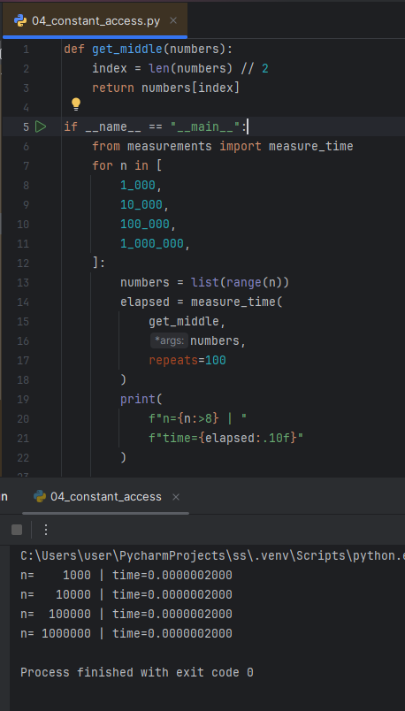

**Что измерялось:** получение срединного элемента из списка.
**Результат:** в списках любого размера получается одинаковое время: 0.0000002 секунды.
**Вывод:** деление длины списка на 2 и получение соотв. индекса имеет константную временную сложность, т.к не зависит от размера входных данных.

## Пример 4. 05_linear_search.py
**Скриншот:**

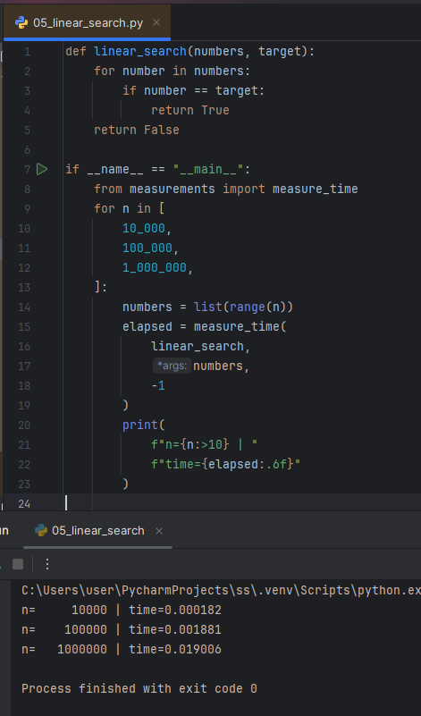

**Что измерялось:** время на нахождение искомого числа (-1) в списках разной величины, при условии, что искомое число отсутствует в каждом.
**Результат:** 10 000 - 0.00018, 100 000 - 0.0018, 1 000 000 - 0.019.
**Вывод:** так как число отсутствует в списках, алгоритм проходит весь список. При этом затраченное время растёт вместе с размеров входных данных: входные данные увеличены в 10 раз - время увеличивается в 10 раз.

## Пример 5. 06_quadratic.py
**Скриншот:**

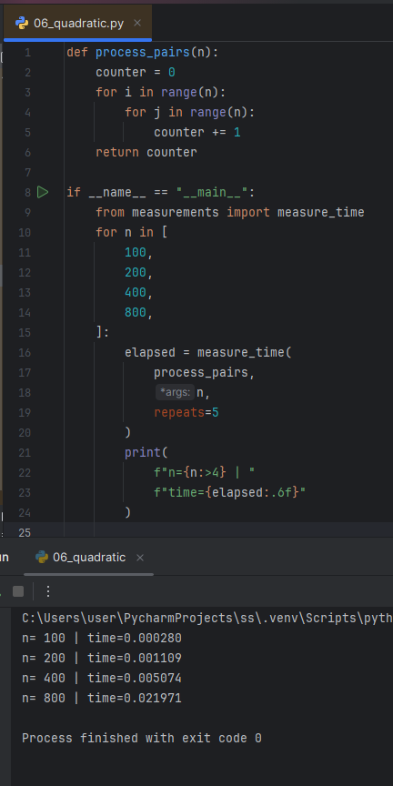

**Что измерялось:** время, затраченное на перебор (подсчёт количества) всех пар чисел в двух списках.
**Результат:** входные данные увеличивается в 2 раза -> время увеличивается в 4.
**Вывод:** алгоритм подсчёта пар обладает квадратичной сложностью, т.к время = входные данные^2.

## Пример 6. 07_list_vs_set.py
**Скриншот:**

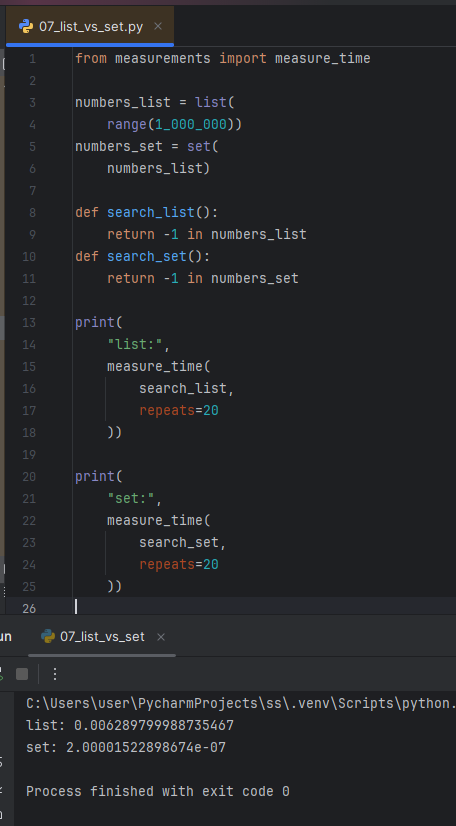

**Что измерялось:**
**Результат:**
**Вывод:**

## Пример 7. 10_final_experiment.py
**Скриншот:**

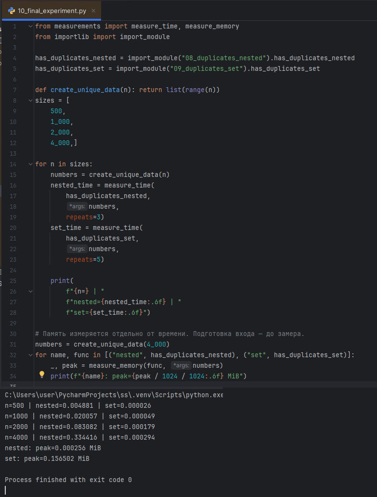

**Что измерялось:** скорость поиска значения в списке и множестве.
**Результат:** поиск в списке - 0.0063 секунды, во множестве - 0.0000002 секунды.
**Вывод:** поиск значения во множестве имеет константное время поиска, т.к множество использует хэш-таблицу, откуда значения вытаскиваются мгновенно, а для поиска значения в списке нужно обойти весь список (в худшем случае).

## Пример 8. 11_sum_comparison.py
**Скриншот:**

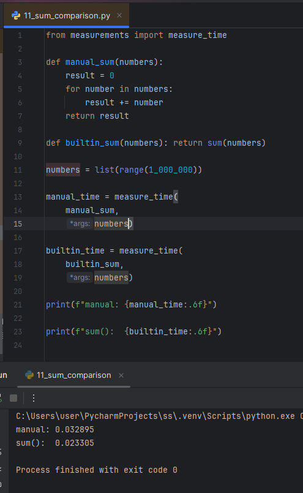

**Что измерялось:** время, затраченное на "ручное" суммирование чисел, и при помощи использования встроенной функции sum().
**Результат:** ручное - 0.03, встроенная функция - 0.02.
**Вывод:** встроенные функции языка работают быстрее, чем их "ручные" аналоги.

## Пример 9. 12_memory_comparison.py
**Скриншот:**

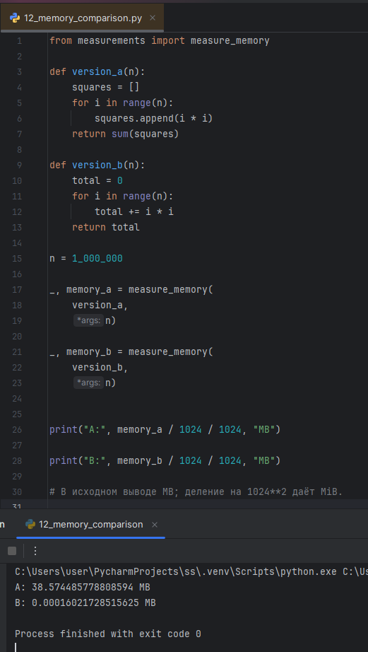

**Что измерялось:** память, которая затрачивается при добавлении значений в список и последующем суммировании значений, и умножении чисел и суммирования их к 1 переменной.
**Результат:** при добавлении в список тратится 38 мб памяти, при использовании переменной - 0.0001 мб.
**Вывод:** создание и использование структур данных требует больше места в памяти, чем создание и использование переменных.

## Пример 10. 13_list_generator.py
**Скриншот:**

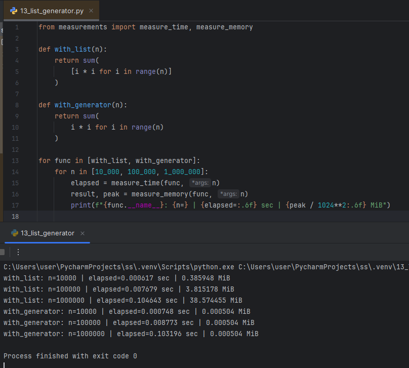

**Что измерялось:** время и потреляемая память при использовании списка и генератора для суммирования чисел в диапазоне.
**Результат:** если время примерно одинаковое, то память отличается куда сильнее: при использовании списка потребляется 0.38, 3.8  и 38 мб соотственно, тогда как для генератора - 0.0005 во всех случаях.
**Вывод:** не смотря на то, что время при разных методах практически одинаково, потребление памяти сильно отличается, т.к в случае со списком нам надо создавать новую структуру и занимать место в памяти, а генератор места практически не требует.

## Пример 11. 14_repeated_runs.py
**Скриншот:**

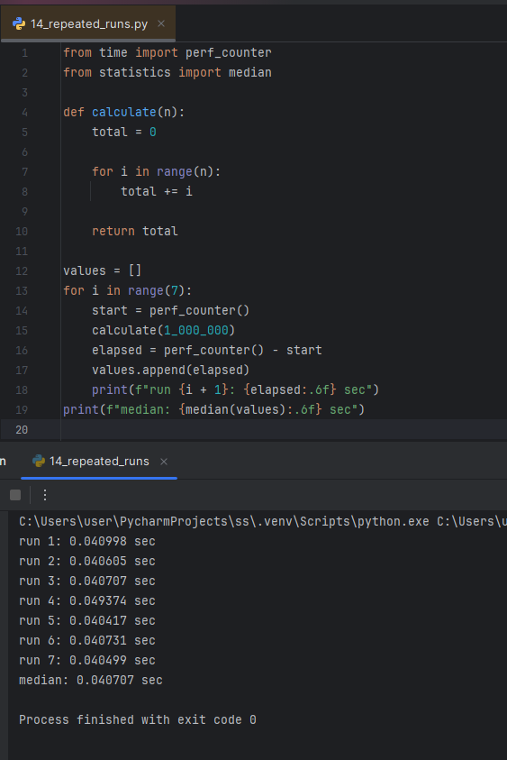

**Что измерялось:** медиана из 7 прогонов одной функции calculate.
**Результат:** 7 временных результатов и медиана на их основе.
**Вывод:** для более точного определения времени, затраченного на выполнение кода, лучше делать несколько замеров и искать их медиану.